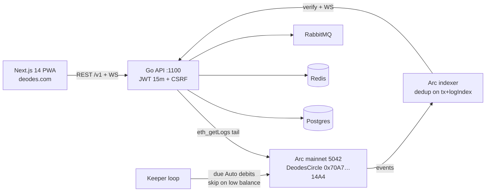

# Deodes — 3-Minute Judge Demo

Live site: **https://deodes.com** · Chain: **Arc mainnet (5042)** · Logo: **https://deodes.com/logo.jpg**

## The story (30s)
Deodes digitizes rotating savings circles (esusu, tontine, chit funds) for the
1.7B+ unbanked: members contribute USDC on a schedule, one member takes the
pool each round, smart contracts + backend enforce the rules, DeoScore builds
portable reputation. Arc finality is sub-second; fees are sub-cent.

## Click path (2 min)
1. **Sign up** with Google (one click, hosted Arc wallet auto-created — that
   address on the Wallet page is yours, no extension needed).
2. **Explore circles** → join one (pick **Manual** to pay per round yourself,
   or tick **Auto-pay** to authorize pulls with a full-circle cap).
3. **Contribute** USDC to the round (native Arc USDC, 18 decimals).
4. **Payouts tab** — protocol takes exactly 50 bps on-chain
   (`fee = pool * 50 / 10000`, verifiable in `DeodesCircle.payout`), the rest
   goes to the recipient; rotation pays every member once before repeating.
5. **DeoScore** (0–1000, weights 35/30/20/15) moves with on-time behavior.

## Architecture (30s)


Key files for judges:
- Contracts: `src/DeodesCircle.sol` (`payout`, 50 bps fee), `src/IDeodesEvents.sol`
  (12-event schema), `test/DeodesCircle.t.sol` (incl. fuzz + vectors tests).
- Backend: `internal/indexer/arc_poller.go`, `internal/domain/circle/distribution.go`
  (exact fee math mirroring the contract), `internal/domain/subscription/keeper.go`.
- Frontend: one-wallet model — signup auto-provisions the hosted wallet;
  external wallets are link-and-sweep funding only (`/wallet/link-external`).

## Don't demo
- Forgot-password email delivery (needs a `DEODES_BREVO_API_KEY` in prod).
- Anything requiring a second wallet login (removed by design).
```
